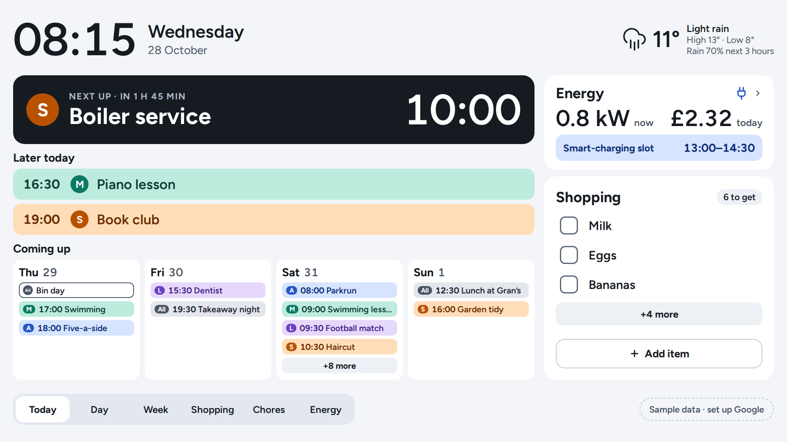
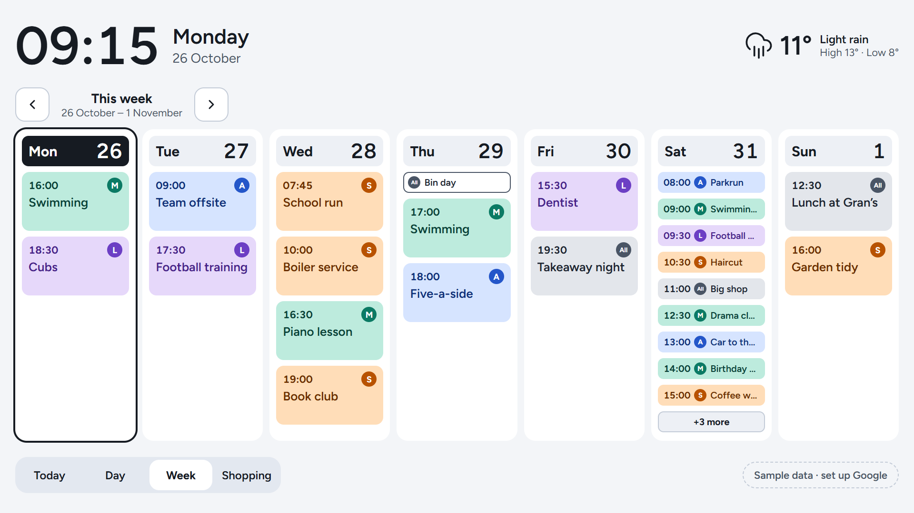
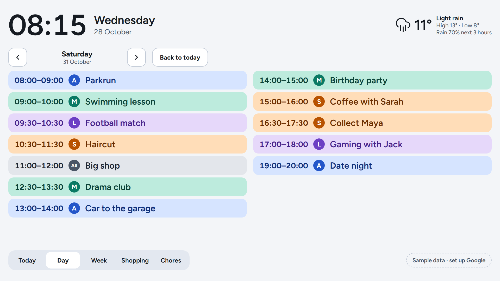

# FamilyHub

**A family wall display for the kitchen.** One glance at a touchscreen by the kettle shows what's on today and who it's for, the week ahead, and the shopping list. Nobody has to ask, shout up the stairs, or check four phones.



<sub>The Today view, running on a PC with sample data.</sub>

FamilyHub is a personal project, built by one family for its own kitchen. Building it is as much the point as using it. It aims to end up as well-engineered as production software at work, and gets there a step at a time.

## What it does

- **Shows everyone's day at a glance.** It reads the Household's Google Calendars: one per person, plus a shared Family calendar. Each person has a colour and an initial, so you can tell whose an Event is from across the room.
- **Keeps the shopping list on the wall.** Add or tick off items on the screen, and in the shop on your phone. The list lives in Google Tasks, so phones need nothing new. *(Coming next.)*
- **Fits a busy day without scrolling.** Busy days switch to compact rows, and anything that still doesn't fit goes behind a "+N more" that opens the full day. Nothing is cut off silently.
- **Looks after itself.** It keeps showing the last plan if the Wi-Fi drops, says when it last updated, and tells the family in plain words when it needs attention.
- **Stays at home.** It runs on a Raspberry Pi in the kitchen, and nothing on the internet can reach it.

## Screenshots

| Week view | Day view |
|---|---|
|  |  |
| Seven days at a glance. A busy day switches to compact rows, and "+3 more" opens the full day. All-day Events (outlined, like "Bin day") sit above timed ones (filled, led by their time). | Every Event in one day, in two columns when it's busy. Reached from "+N more", any day's heading, or the bottom bar. |

The screenshots use the app's built-in sample week. On the real Hub, the corner shows when the Calendars last updated instead of "Sample data".

## Where it's going

The plan is in [docs/requirements.md](docs/requirements.md). Progress so far:

| | Milestone | Status |
|---|---|---|
| ✅ | Repo, requirements and mockups | Done |
| ✅ | Today, Day and Week views | Done, on a PC |
| ✅ | Real Google Calendars | Done, on a PC |
| ⬜ | Shopping list from Google Tasks | Next |
| ⬜ | Real weather (Open-Meteo) | |
| ⬜ | A Raspberry Pi set up from scripts, showing the Hub full-screen | |
| ⬜ | Overnight sleep, and a Day and Evening theme | |
| ⬜ | Offline resilience, then on the kitchen wall: **v1** | |
| ⬜ | Recipe videos from a YouTube playlist | After v1 |
| ⬜ | A motion sensor that wakes it when someone walks in | After v1 |
| ⬜ | Adding to the shopping list by asking Alexa | Later |

v1 is done when it's been on the wall for two weeks and nobody goes back to checking their phone for the day's plan.

## How it's built

- **App:** [SvelteKit](https://svelte.dev/docs/kit) with strict TypeScript, providing both the screen and a small server behind it, in [`app/`](app/README.md).
- **Data:** Google Calendar (read-only) and Google Tasks, signed in as the Household's one Google account. Weather from Open-Meteo.
- **Hardware:** a Raspberry Pi 5 with a 15.6″ 1080p touchscreen, running the app full-screen in a browser ([why a Pi](docs/adr/0001-web-app-on-raspberry-pi.md)).
- **Hosting:** none. Everything runs on the Pi and nothing is reachable from the internet ([ADR 0002](docs/adr/0002-everything-runs-on-the-pi.md)). The Pi will pull its own releases and roll back if one is unhealthy ([ADR 0004](docs/adr/0004-pi-pulls-releases.md)).
- **Monitoring:** OpenTelemetry to Azure Application Insights, with anything personal stripped before it leaves the house ([ADR 0005](docs/adr/0005-telemetry-via-otel-collector-to-app-insights.md)).

## Run it yourself

You need Node.js 24 or later.

```
cd app
npm install
npm run dev
```

Open <http://localhost:5173>. It starts with sample data. To show real Google Calendars, follow [the Google Cloud runbook](docs/runbooks/google-cloud-setup.md), then choose **Sample data · set up Google** in the corner. More detail is in [app/README.md](app/README.md).

## Find your way around

| Path | What's there |
|---|---|
| [`app/`](app/README.md) | The Hub itself |
| [`docs/requirements.md`](docs/requirements.md) | Scope, quality bar, milestones, and what "v1 done" means |
| [`GLOSSARY.md`](GLOSSARY.md) | The words the project uses for things, such as Hub, Member and Section |
| [`docs/adr/`](docs/adr/) | Why the big decisions went the way they did |
| [`docs/runbooks/`](docs/runbooks/) | Step-by-step setup guides |
| [`design/mockups/`](design/mockups/README.md) | The original UI mockups. Open `html/index.html` in a browser. |
| [`docs/diagrams/familyhub-pitch.html`](docs/diagrams/familyhub-pitch.html) | A one-page visual pitch of the idea, written for the family. Open it from a local checkout. |
