# FamilyHub

**A family wall display for the kitchen.** One glance at a touchscreen by the kettle shows what's on today and who it's for, the week ahead, the jobs that are due, and what the electricity is costing. Nobody has to ask, shout up the stairs, or check four phones.


<sub>The Today view, running on a PC with sample data.</sub>

FamilyHub is a personal project, built by one family for its own kitchen. Building it is as much the point as using it. It aims to end up as well-engineered as production software at work, and gets there a step at a time.

## What it does

- **Shows everyone's day at a glance.** It reads the Household's Google Calendars: one per person, plus a shared Family calendar. Each person has a colour and an initial, so you can tell whose an Event is from across the room, and the colours include Google Calendar's own, so they can match everyone's phones. Tap any Event to see its full title and times.
- **Keeps the shopping list on the wall.** Add or tick off items on the screen, and in the shop on your phone. The list lives in the Hub's own backend, and phones use the family app, which works with no signal in the shop. Tap to tick off, long-press to remove.
- **Keeps the family's To-dos in view.** One-off and repeating jobs from a Google Tasks list. The Today view shows what's overdue and due today, then the jobs with no date, which anyone can pick up. Tick them off at the screen or on a phone.
- **Makes chores a game for the kids.** Each child has a lane of Chores for the morning, after school and the evening, ticks them off at the screen, and earns Stars. Bonus jobs are up for grabs for extra Stars, and children who do one together each get them. Finishing a Routine gets a chime and a burst of stars.
- **Has games for everyone.** Word of the day: a new five-letter word each day, the same for the whole Household, with six goes to find it. Each Member taps their name and plays their own game, can stop and carry on later, and the screen never shows anyone's answer: a finished game shows only its colours. Getting the word plays a chime and a burst of stars, and finishing a game each day, found or not, keeps a streak going. Number of the day: six numbers and a target from 101 to 999, the same for everyone each day and always reachable, to make by adding, taking away, multiplying and dividing, with taps only. Each step joins two numbers into a new one, a step that would give a fraction, zero or less is turned down with the reason, and Undo, Start again and Stop for now are always there. Making the target finishes the game with a chime and a burst of stars, or Finish with… settles on the closest number for a quieter "So close!". Either way the player sees their steps beside one of the shortest ways to the target, worked out by the Hub, until the celebration closes, and finishing keeps Number of the day's own streak going. The cards show only "Got it" or how far away, never how. The Games tab opens on the game chosen last that day. Games earn no Stars.
- **Shows when electricity is cheap, and where it goes.** It reads the Household's Intelligent Octopus Go rates and Smart-charging slots from Octopus, and the Zappi car charger's usage from myenergi. It shows what the house is using now, what today has cost, and when to start the dishwasher, washing machine and tumble drier so they finish while it's cheap. Each half-hour is split into the house and the car.
- **Shows how warm the house is.** Beside the outdoor weather, the header shows the inside temperature and humidity from the Nest thermostat, and what the heating is doing: heating to a target, set to one, in Eco or off. If the Nest stops reporting, it says since when rather than show an old temperature. Tap it to turn the heating up or down: − and + change the target half a degree at a time, between 16° and 22°, and it lasts until the Nest's schedule next changes, just like turning the dial. The schedule, Eco and Off stay in the Nest app.
- **Fits a busy day without scrolling.** Busy days switch to compact rows, and anything that still doesn't fit goes behind a "+N more" that opens the full day. Nothing is cut off silently.
- **Types at the wall.** Its own on-screen keyboard opens for any box, and slides the page up so the box stays in view.
- **Is set up at the wall.** A gear in the bottom bar opens Settings: a 24-hour or 12-hour clock, a Light, Dark or Auto theme (Auto follows sunrise and sunset), the Household's Members with their colours and Calendars, the To-do list, the Hub's Google account and the Nest, locked until held for a second. It also shows which version is running, when it was built, how long it's been up, how warm the Pi is, to tell whether it needs a fan, and which network it's on.
- **Looks after itself.** It's on the home network by its cable, with its Wi-Fi and Bluetooth switched off ([ADR 0015](docs/adr/0015-the-pi-is-wired-only.md)), keeps showing the last plan if the network drops, says when it last updated, and tells the family in plain words when it needs attention.
- **Stays at home.** It runs on a Raspberry Pi in the kitchen, and nothing on the internet can reach it.

## Screenshots

| Week view | Day view |
|---|---|
| 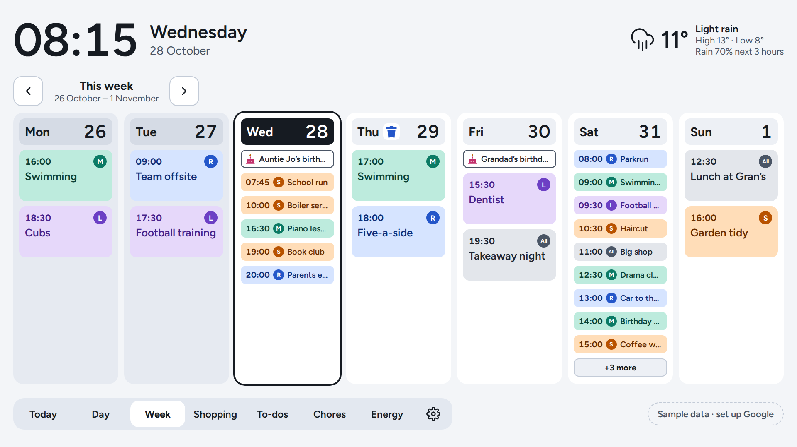 | 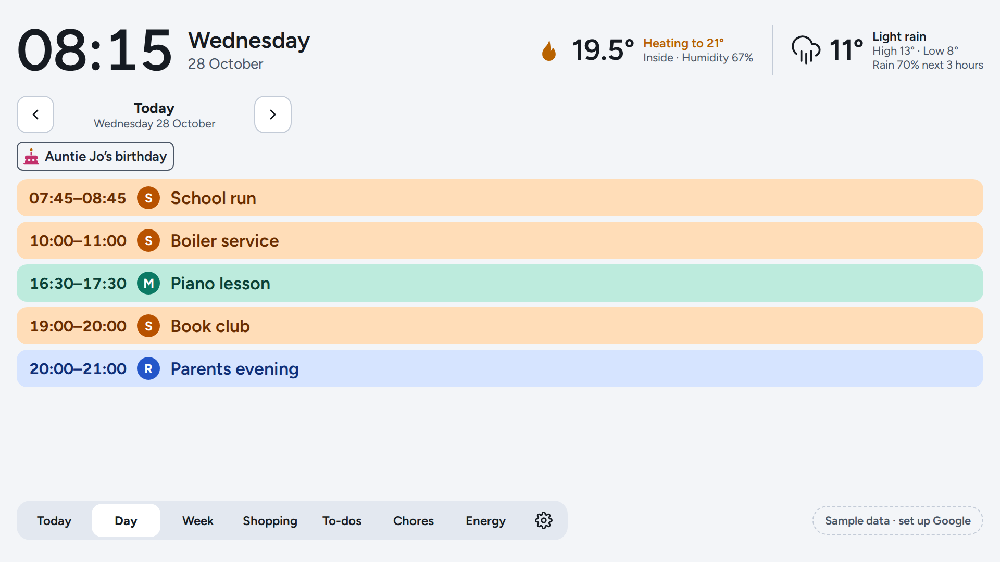 |
| The next seven days at a glance, starting with today. A busy day switches to compact rows, and "+3 more" opens the full day. All-day Events (outlined, like "Bin day") sit above timed ones (filled, led by their time). | Every Event in one day, in two columns when it's busy. Reached from "+N more", any day's heading, or the bottom bar. |

| Chores | Finishing a Routine |
|---|---|
| 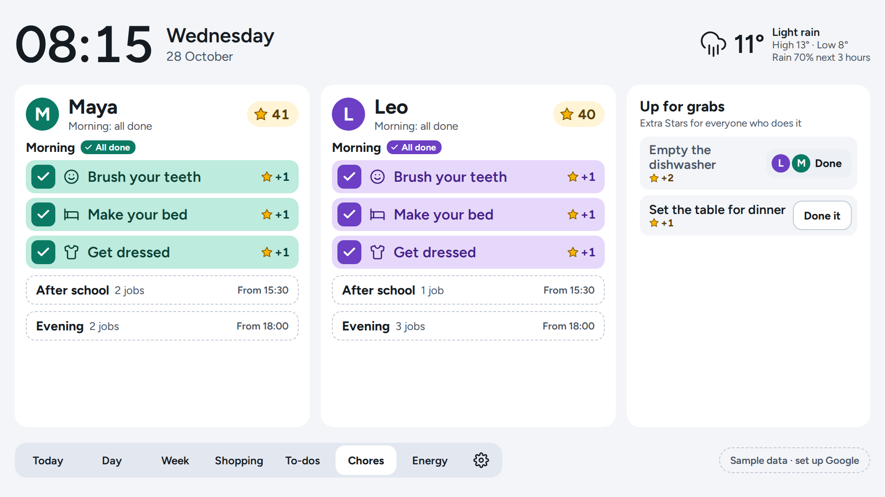 | 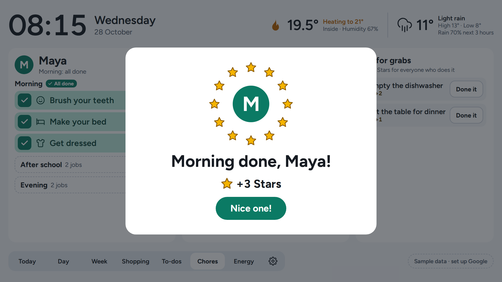 |
| A lane per child, with the Routine whose time it is open and the rest folded away. A tap ticks a Chore off and earns its Stars. Bonus jobs are up for grabs for whoever does them first. | Ticking off the last Chore of a Routine plays a chime and shows a burst of stars, which closes by itself. |

| Energy | To-dos |
|---|---|
|  | 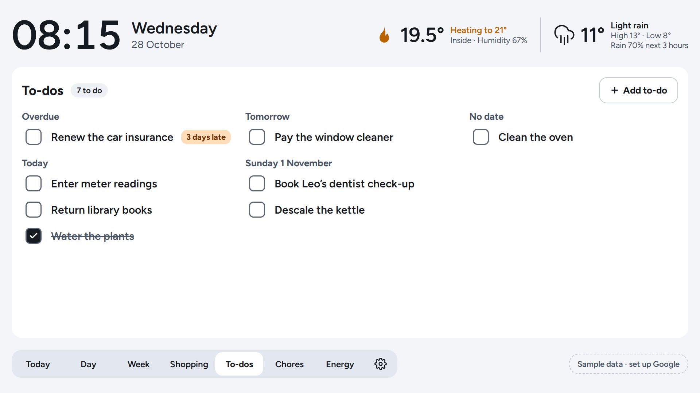 |
| The price now, what the house is using, and the next cheap time. Today's half-hours show the car's charging stacked on the house's use, over which were Peak, Off-peak or a Smart-charging slot. Each appliance gets a window to start in so it finishes while it's cheap, and yesterday's cost is split into the house and the car. | Every To-do, grouped by when it's due. One-off To-dos can be added at the screen with a due date; repeating ones are set up on a phone. |

| Tapping an Event | The on-screen keyboard |
|---|---|
| 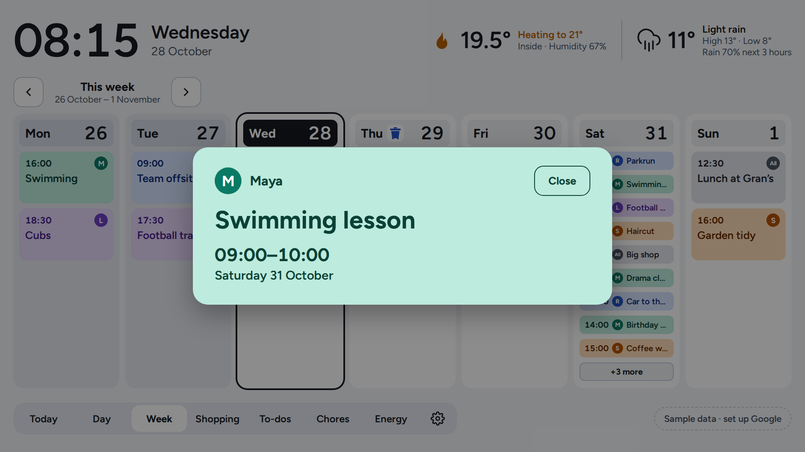 | 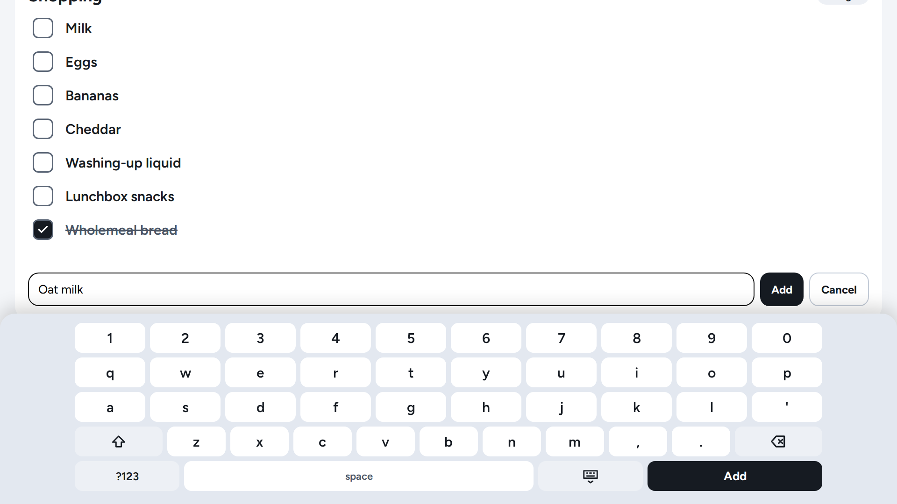 |
| Titles are often cut short on the views. A tap shows the whole title, whose it is, its day and its times. | Opens for any box. Numbers along the top, £ in the symbols, and Enter says what it'll do, such as "Add". |

| Settings |
|---|
| 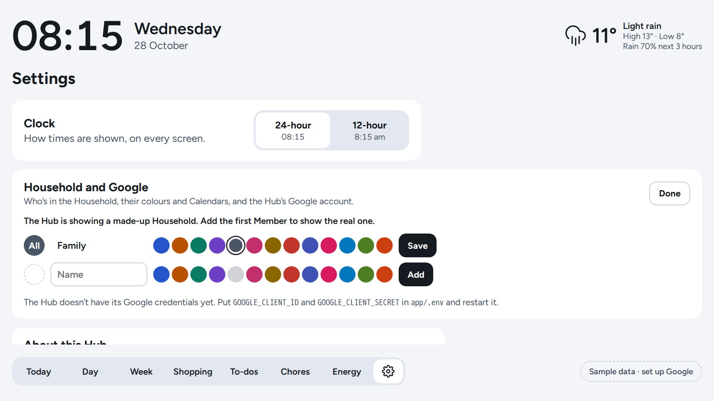 |
| A 24-hour clock unless 12-hour is chosen, for every time on the screen. Below it, the Household: each Member's name, colour and Calendar, the Family calendar, the lists and Google, locked until held so nobody changes it by accident. About this Hub says what's running, to check a release reached the Pi. |

| Games | Word of the day |
|---|---|
| 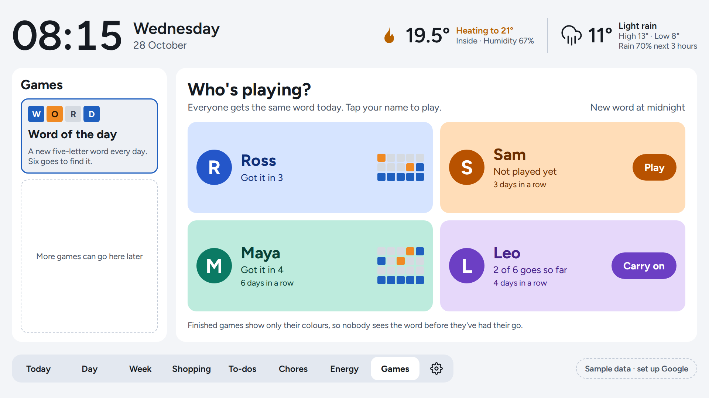 | 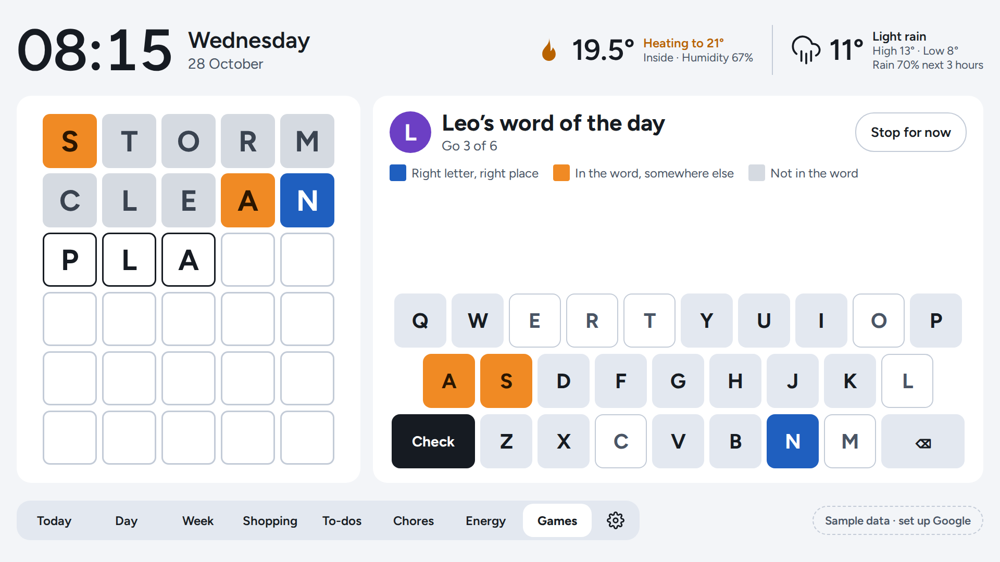 |
| Everyone gets the same word each day. A tap on your name starts your game or carries it on. Finished games show only their colours, so nobody sees the word before they've played. | Blue is the right letter in the right place, orange is in the word somewhere else, and grey isn't in it. A word the Hub doesn't know uses no go. |

| Number of the day | Playing it |
|---|---|
| 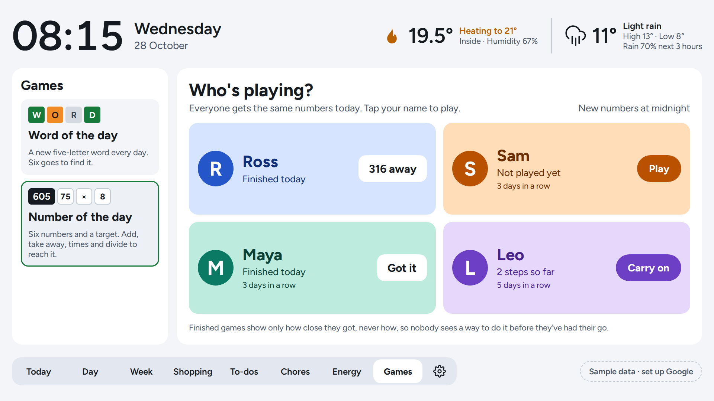 | 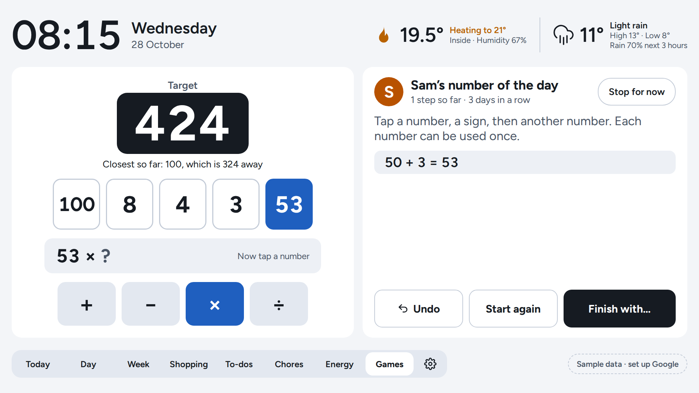 |
| Everyone gets the same six numbers and target each day. Finished games show only "Got it" or how far away they finished, never how. | Tap a number, a sign, then another number: the two become their answer. Closest so far shows the nearest number on the board. |

The screenshots use the app's built-in sample week, sample Chores, sample To-dos, sample energy, sample heating and sample games, and are copied from the screenshot tests. On the real Hub, the corner shows when the Calendars last updated instead of "Sample data".

## Where it's going

The plan is in [docs/requirements.md](docs/requirements.md). Progress so far:

| | Milestone | Status |
|---|---|---|
| ✅ | Repo, requirements and mockups | Done |
| ✅ | Today, Day and Week views | Done, on a PC |
| ✅ | Real Google Calendars | Done, on a PC |
| ✅ | Shopping list from Google Tasks | Done, then moved to the backend |
| ✅ | Real weather (Open-Meteo) | Done, on a PC |
| ✅ | Tests and CI: unit tests, screenshot tests, GitHub Actions | Done |
| ✅ | Chore chart, first slice: kids tick off their Chores for Stars ([design](design/mockups/chores/notes.md)) | Done, on a PC |
| ✅ | Overnight sleep, with its hours chosen in Settings, and a Day and Evening theme, or either all the time | Done, on a PC |
| ✅ | Offline resilience | Done, on a PC |
| ✅ | A versioned release built on every merge | Done |
| ✅ | Home energy: cheap and peak times, when to run the dishwasher, the car’s share, and its charge ([design](design/mockups/energy/notes.md)) | Done, on a PC |
| ✅ | To-dos from Google Tasks, one-off and repeating ([design](design/mockups/todos/notes.md)) | Done, on a PC |
| ✅ | Settings, Google Calendar's colours, and tapping an Event for its details | Done, on a PC |
| ✅ | The Household set up in Settings and kept in the Hub's database, not the Key Vault ([ADR 0012](docs/adr/0012-household-and-settings-in-the-hub-database.md)) | Done, on a PC |
| ⬜ | The heating from the Nest ([ADR 0013](docs/adr/0013-the-nest-through-googles-sdm-api.md), [design](design/mockups/heating/README.md)) | In progress: shown in the header, and the target changed from the Hub. Still to come: the bathroom floor |
| ⬜ | A Raspberry Pi set up from scripts, showing the Hub full-screen | In progress: set up from scripts, pulling its own releases, full-screen, with its secrets from the Key Vault, and an on-screen keyboard. The screen goes dark for Lights out, inside Sleep, and lights at a touch |
| ✅ | Games: Word of the day, with a celebration and streaks ([design](design/mockups/games/notes.md)) | Done, on a PC |
| ✅ | Games: Number of the day, with a celebration, one way to reach the target, and streaks ([design](design/mockups/games/notes.md#number-of-the-day)) | Done, on a PC |
| ⬜ | On the kitchen wall: **v1** | |
| ⬜ | The Shopping list and To-dos in a backend of the Hub's own, with a family app for phones ([design](design/family-app/notes.md)) | In progress: the backend's Azure resources and sign-in, with each Member's own Google account, are built ([ADR 0014](docs/adr/0014-household-accounts-in-cosmos-db.md)), and the backend keeps the Shopping list and tells connected devices when it changes. The family app installs on a phone from Static Web Apps, each Member signs in to it once with their own Google account and stays signed in while they use it ([ADR 0016](docs/adr/0016-sign-in-held-by-the-backend.md)), and it shows the backend's Shopping list, to add, tick, change and remove items, with Undo after a remove. It can sort the list in a shop's walking order: pick the shop, drag items into place by their handles, and the shop learns, so the next trip starts sorted. It keeps working with no signal, from a copy on the phone, and sends the changes when the signal's back, and changes made elsewhere show on an open app within about a second. The Hub signs in to the backend as itself, with a certificate, and holds a live connection to it. The Hub's Shopping list is the backend's, so a change made on a phone shows on the wall in under a second, and one made on the wall shows on the phone. Still to come: To-dos and repeats (slice 6) |
| ⬜ | Recipe videos from a YouTube playlist | After v1 |
| ⬜ | A motion sensor that wakes it when someone walks in | After v1 |
| ⬜ | The rest of the chore chart: streaks, the family jar and Rewards | After v1 |
| ⬜ | Adding to the shopping list by asking Alexa | Later |

v1 is done when it's been on the wall for two weeks and nobody goes back to checking their phone for the day's plan.

## How it's built

- **App:** [SvelteKit](https://svelte.dev/docs/kit) with strict TypeScript, providing both the screen and a small server behind it, in [`app/`](app/README.md).
- **Data:** Google Calendar (read-only) and Google Tasks, signed in as the Household's one Google account. Weather from Open-Meteo.
- **Hardware:** a Raspberry Pi 5 with a 1080p touchscreen, provisionally a 21.5″ Waveshare (not bought yet), running the app full-screen in Chromium inside cage, with no desktop behind it ([why a Pi](docs/adr/0001-web-app-on-raspberry-pi.md), [the kiosk](docs/adr/0009-kiosk-is-chromium-in-cage.md)). The Pi is on its network cable only, as it sits inside the screen's metal housing ([ADR 0015](docs/adr/0015-the-pi-is-wired-only.md)).
- **Hosting:** none. Everything runs on the Pi and nothing is reachable from the internet ([ADR 0002](docs/adr/0002-everything-runs-on-the-pi.md)). The Pi pulls its own releases and rolls back if one is unhealthy ([ADR 0004](docs/adr/0004-pi-pulls-releases.md)).
- **Data:** the Hub's own data lives in SQLite on the Pi, backed up nightly to Google Drive: the Chores' record ([ADR 0006](docs/adr/0006-hub-owned-data-in-sqlite.md)), and the Household and everything chosen in Settings ([ADR 0012](docs/adr/0012-household-and-settings-in-the-hub-database.md)). The Key Vault holds only secrets.
- **Monitoring:** OpenTelemetry to Azure Application Insights, with anything personal stripped before it leaves the house ([ADR 0005](docs/adr/0005-telemetry-via-otel-collector-to-app-insights.md)).
- **Azure:** the Key Vault, Application Insights, and the family app's backend (Azure Functions on Flex Consumption, Cosmos DB and Web PubSub, [ADR 0010](docs/adr/0010-shared-lists-in-an-azure-backend-with-an-installable-family-app.md), [ADR 0011](docs/adr/0011-backend-runs-on-functions-flex-consumption.md)) are built from Bicep by an Azure DevOps pipeline, resource group included, in FamilyHub's own subscription, on free tiers unless something billable has been approved ([ADR 0008](docs/adr/0008-azure-resources-from-bicep-through-azure-devops.md)).

## Run it yourself

You need Node.js 24 or later.

```
cd app
npm install
npm run dev
```

Open <http://localhost:5173>. It starts with sample data. To show real Google Calendars and the Shopping list, follow [the Google Cloud runbook](docs/runbooks/google-cloud-setup.md), then choose **Sample data · set up Google** in the corner, unlock Household and Google, sign in, and add the Household. More detail is in [app/README.md](app/README.md), including `node scripts/card-dev.mjs`, which runs a card's work in progress with the real setup at its own address while it's built.

## Find your way around

| Path | What's there |
|---|---|
| [`app/`](app/README.md) | The Hub itself |
| [`ansible/`](ansible/README.md) | The scripts that set up the Pi |
| [`family-app/`](family-app/README.md) | The family app for phones: an installable web app on Static Web Apps, being built |
| [`backend/`](backend/README.md) | The family app's backend: a FastAPI service on Azure Functions, being built |
| [`infra/`](infra/README.md) | The Azure resources, in Bicep, and the pipeline that deploys them |
| [`docs/requirements.md`](docs/requirements.md) | Scope, quality bar, milestones, and what "v1 done" means |
| [`GLOSSARY.md`](GLOSSARY.md) | The words the project uses for things, such as Hub, Member and Section |
| [`docs/adr/`](docs/adr/) | Why the big decisions went the way they did |
| [`docs/runbooks/`](docs/runbooks/) | Step-by-step setup guides |
| [`site/`](site/) | The public [home page](https://rosskgraham.github.io/FamilyHub/) and [privacy policy](https://rosskgraham.github.io/FamilyHub/privacy.html) Google asks for before the Hub's Google app is published |
| [`docs/ways-of-working.md`](docs/ways-of-working.md) | How work moves from an idea to the wall: the private board, evidence, independent review and checking on the Pi |
| [`scripts/`](scripts/) | The board helper and the independent review launcher |
| [`design/mockups/`](design/mockups/README.md) | The original UI mockups. Open `html/index.html` in a browser. The Chores designs are in [`chores/`](design/mockups/chores/README.md), the family app's phone screens in [`family-app/`](design/mockups/family-app/README.md), and the parked portrait designs in [`portrait/`](design/mockups/portrait/README.md). |
| [`design/family-app/notes.md`](design/family-app/notes.md) | The design of the backend and the family app for phones, and its slices |
| [`docs/diagrams/familyhub-pitch.html`](docs/diagrams/familyhub-pitch.html) | A one-page visual pitch of the idea, written for the family. Open it from a local checkout. |
